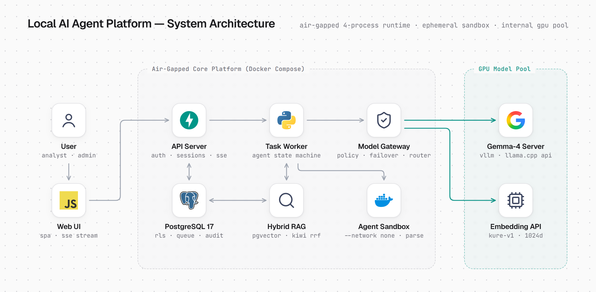
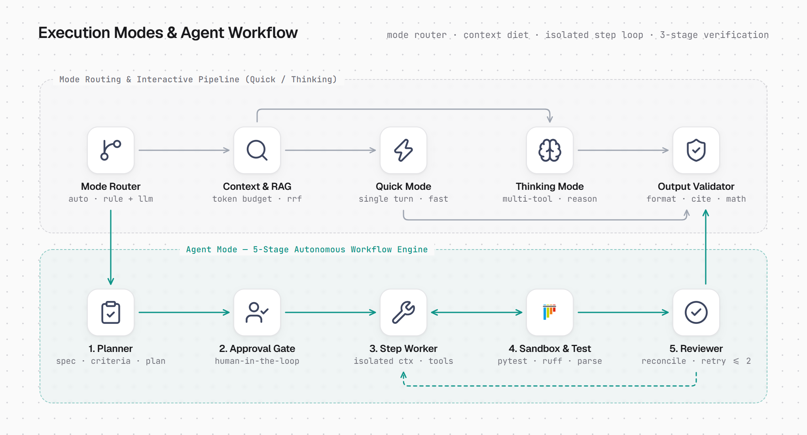

# 폐쇄망 Local AI Agent Platform

사내 폐쇄망에서 오픈 가중치 LLM으로 문서 분석, 데이터 분석, 프로그램 개발을 끝까지 수행하는 에이전트 플랫폼입니다.
[설계서](docs/architecture.md)(2026-11-10)의 **0단계와 1단계**를 구현한 코드입니다. 2단계(목표 GPU에서의 모델 확정·튜닝) 이후는 하드웨어가 있어야 진행할 수 있습니다.

상시 프로세스는 4개입니다: API 서버, 작업 워커, PostgreSQL, 모델 서버. 모델로 가는 길은 게이트웨이 하나이고,
작업의 완료는 모델이 아니라 테스트와 규칙 검사가 판정합니다.

처음 맡는 사람은 [HANDOVER.md](HANDOVER.md)(인수인계)부터 읽으세요.

## 시스템 구성도

### 1. 전체 시스템 및 폐쇄망 배포 구성

사내 폐쇄망 내부의 **Core Platform(Docker Compose)** 과 **GPU Model Pool** 의 경계, 그리고 외부 통신이 차단된 일회용 **Agent Sandbox(`--network none`)** 의 물리·논리적 흐름입니다.

<p align="center">
  <picture>
    <source media="(prefers-color-scheme: dark)" srcset="docs/arch-system-dark.png">
    <source media="(prefers-color-scheme: light)" srcset="docs/arch-system.png">
    
  </picture>
</p>

### 2. 실행 모드 라우팅 및 자율 에이전트 검증 루프

요청 접수 후 **Mode Router**와 **Context & RAG**를 거쳐 **Quick · Thinking** 파이프라인으로 처리되거나, **Agent Mode**의 5단계 자율 실행·결정론적 검증·자가 수정(`retry <= 2`) 상태 기계로 이어지는 단계별 흐름입니다.

<p align="center">
  <picture>
    <source media="(prefers-color-scheme: dark)" srcset="docs/arch-workflow-dark.png">
    <source media="(prefers-color-scheme: light)" srcset="docs/arch-workflow.png">
    
  </picture>
</p>

## 검증한 범위와 하지 못한 범위

| 구분 | 내용 |
|---|---|
| 검증함 | 통합 테스트 134개. 실제 PostgreSQL(pgvector), 실제 샌드박스 컨테이너, 실제 API 서버·워커 프로세스를 띄우고 HTTP로 시험 |
| 검증함 | 같은 테스트 전체를 네트워크를 끈 상태에서 실행해 통과(`scripts/test-offline.sh`) |
| 검증함 | 두 이미지를 외부 색인 없이(`--network none`) 빌드. Docker Compose 배포 구성에서 브라우저로 로그인 → Quick → 첨부 + Thinking → Agent 승인·완료까지 실행 |
| 검증함 | 500명 혼합 시나리오에서 API·DB 계층 오류 0건(아래 "부하 테스트") |
| **검증 못 함** | **실제 LLM과의 연동.** 개발한 환경에는 GPU가 없고 모델을 내려받을 수 없어, OpenAI 호환 API의 모양을 흉내 낸 가짜 모델 서버(`tests/fake_model.py`)로만 시험했습니다. llama.cpp·vLLM의 스트리밍 조각, 도구 호출, `<think>` 태그·코드 블록이 섞인 JSON 스키마 출력에 대한 방어 처리를 `app/gateway.py`에 넣어 두었으나, 개발 PC에서 실제 모델을 붙여 가장 먼저 확인해야 합니다. 2026-11-13에 CPU 구성으로 첫 확인을 했습니다: [docs/laptop-cpu.md](docs/laptop-cpu.md) |
| 검증 못 함 | 답변 품질. 평가셋 점수는 실제 모델을 붙여야 나옵니다 |

## 착수 전 결정 사항의 반영

| 항목 | 받은 답 | 반영 |
|---|---|---|
| 사내 GPU | 미정 | 2단계에서 두 급(24~48GB 1장, 80GB 1장)으로 각각 측정하도록 남겨 둠. 코드에서 바뀌는 것은 `config/models.yaml`뿐 |
| 목표 동시 사용자 | 500명 | `loadtest/locustfile.py`의 목표값. 통과 기준(지연·오류율)은 2단계 기준선 측정 뒤에 정함 |
| 데이터 등급 체계 | 초안 없음 | 5단계 초안을 구성: [docs/data-grades.md](docs/data-grades.md), `config/policy.yaml` |
| 개발 PC GPU | RTX 3060 Ti (8GB) | `config/models.yaml`을 Gemma 4 E4B 4비트 GGUF + llama.cpp, 컨텍스트 8K 기준으로 작성 |
| 모델 출처 허용 기준, 평가 문항을 만들 현업 담당자 | 답 없음 | 미정으로 둠. 평가셋은 씨앗 56문항 |

**500명에 대해.** 이 숫자가 "로그인해 대화 중인 사람 500명"이라면, 같은 순간 모델이 처리하는 요청 수는 `500 × 응답 시간 ÷ (응답 시간 + 다음 질문까지의 시간)`입니다.
응답 10초, 생각 시간 30초면 약 125건입니다. 설계서의 전제(GPU 1~2장)와는 차이가 큰 값이라, 2단계에서 GPU 급별 포화 지점을 재서 도입 규모나 목표 인원 중 하나를 조정해야 할 가능성이 높습니다.
Agent 작업은 동시 실행 수에 상한을 두고 큐에 넣으므로(`limits.agent_concurrency`), 인원이 늘면 실패가 아니라 대기가 늘어납니다.

## 개발 PC에서 실행하기

필요한 것: Docker(26 이상), llama.cpp, NVIDIA 드라이버. Windows라면 WSL2 안에서 진행합니다.

GPU가 없는 노트북이라면 모델 서버까지 CPU로 띄우는 [docs/laptop-cpu.md](docs/laptop-cpu.md)를 따릅니다(`scripts/laptop-up.sh` 한 번으로 기동).

**1. 모델 서버 (GPU가 있는 쪽).** 생성 모델과 임베딩 모델을 서로 다른 프로세스로 띄웁니다. 서버의 모델 이름(`--alias`)은 `config/models.yaml`의 `id`와 같아야 합니다.

```bash
llama-server -m <Gemma 4 E4B Q4_K_M GGUF 파일> --mmproj <함께 배포되는 mmproj 파일> --alias gemma-4-e4b -c 8192 -ngl 99 --jinja --host 0.0.0.0 --port 8080
```

```bash
llama-server -m <임베딩 모델 GGUF 파일> --alias kure-v1 --embedding -ngl 0 --host 0.0.0.0 --port 8081
```

- Gemma 4 E4B의 Q4_K_M 파일은 배포처에 따라 5.0~5.4GB로 올라와 있습니다. 8GB VRAM에 8K 컨텍스트로 올라갈 것으로 보지만 실제로 올려 보지는 못했습니다. 모자라면 `-c`를 줄이거나 `--mmproj`를 빼고 `models.yaml`의 `vision`을 지웁니다.
- 임베딩은 CPU로 띄우는 구성입니다. KURE-v1의 GGUF 변환본을 써 보지 못했습니다. 변환이 안 되면 같은 구조·같은 1024차원인 BGE-M3 GGUF로 시작하고 `models.yaml`의 id와 출처를 맞춥니다(출처 심사 대상).
- 내려받은 가중치의 SHA-256을 `models.yaml`의 `provenance.sha256`에 적어 둡니다.
- 설계서는 계열이 다른 모델 2개 이상으로 평가하라고 합니다. 8GB에 올라가는 둘째 모델을 골라 `models.yaml`에 항목을 추가하면 됩니다. 도구 호출 형식을 믿기 어려운 모델은 `tools: schema`로 둡니다.
- 온도 같은 샘플링 값은 플랫폼이 보내지 않습니다. 모델 서버 쪽 설정으로 고정해야 평가 점수를 비교할 수 있습니다.

**2. 휠 번들과 이미지.** 이미지는 외부 색인 없이 `wheels/`에서만 설치합니다. 인터넷이 되는 곳에서 한 번 받아 둡니다.

```bash
scripts/bundle.sh
```

```bash
cp .env.example .env
```

`.env`의 세 값을 채운 뒤 띄웁니다.

```bash
docker compose up -d --build
```

**3. 계정.** 등급은 `public`, `internal`, `restricted`, `pseudonymized`, `personal` 중 하나이고, 뒤에 접근 그룹을 붙일 수 있습니다.

```bash
docker compose exec api python -m app.admin adduser hong 'S3cret!' internal retail
```

**4. 접속.** 브라우저에서 `http://localhost:8000` 을 엽니다.

**5. 사내 문서 색인(선택).** 등급 태그는 필수입니다. 채팅 화면에서 "사내 지식 검색"을 켠 요청과 Thinking·Agent의 `search` 도구가 이 문서를 찾습니다.

```bash
docker compose cp 여비규정.pdf api:/tmp/여비규정.pdf
```

```bash
docker compose exec api python -m app.admin index hong /tmp/여비규정.pdf internal
```

## 구조

```
app/
  api.py         API 서버: 인증, 세션, 요청 접수, 이벤트 스트림(SSE), 사람의 개입(승인·정지·재개·취소)
  worker.py      작업 워커: PostgreSQL을 큐로 써서 Agent 작업을 한 칸씩 진행하고 저장
  gateway.py     Model Gateway: 정책 필터 → 라우터 → OpenAI 호환 어댑터 → 장애 전환·계측
  policy.py      데이터 등급, 한도, 하네스 스위치, 민감정보 마스킹
  modes.py       모드 라우터(Auto 판정, 승격)와 Quick·Thinking 실행 경로
  context.py     Context Manager: 슬롯별 토큰 예산 조립, 이력 압축
  prompts.py     Prompt Manager: prompts/*.md + 모델별 패치(prompts/patches/<모델 ID>/)
  runtime.py     Agent Runtime: 한 역할의 한 단계를 도구로 수행하는 루프
  workflow.py    Workflow Engine: 명세 → 계획 → 승인 → 실행 → 검증 → 요구사항 대조
  tools.py       Tool Manager: 도구 정의(MCP와 같은 모양)와 구현
  sandbox.py     일회용 컨테이너 실행(네트워크 없음, 읽기 전용, 비루트, 자원 제한)
  files.py       File Pipeline: 형식 확인 → 샌드박스에서 파싱 → 색인
  knowledge.py   청킹, 하이브리드 검색(pgvector + Kiwi 형태소, RRF), 권한 필터, 기억
  validator.py   인용 실재 확인, 수치 근거 확인
  trace.py       추적 이벤트, 감사 로그(해시 연쇄)
  auth.py        로컬 계정과 토큰
  admin.py       운영자 명령: adduser, index, verify-audit
  schema.sql     표, 권한, 행 수준 보안
sandbox/         샌드박스 이미지와 파일 파서(parse.py)
config/          models.yaml(모델 레지스트리), policy.yaml(등급·한도·하네스 스위치)
prompts/         프롬프트 템플릿
web/             화면(빌드 없음)
evals/           평가셋과 러너
loadtest/        부하 시나리오
tests/           통합 테스트와 가짜 모델 서버
```

요청 하나는 실행(run) 하나입니다. LLM 호출, 도구 호출, 검증 결과가 같은 `events` 표에 남고, 화면에 보내는 진행 이벤트도 같은 내용입니다.
Quick과 Thinking은 API 서버 안에서 바로 실행하고, Agent는 큐에 넣어 워커가 실행합니다.

**세 모드**

| 모드 | 경로 | 검증 |
|---|---|---|
| Quick | LLM 1회. 첨부가 있으면 그 내용(작으면 전문, 크면 검색 결과)을 함께 넣음 | 형식(빈 응답, 잘린 응답). 실패하면 Thinking으로 승격 |
| Thinking | 추론을 켠 도구 호출 루프. 읽기 도구와 계산용 코드 실행 | 인용 번호가 준 자료에 있는지, 세 자리 이상 수치가 자료나 실행 결과에 있는지. 실패하면 1회 수정 |
| Agent | 상태 기계. 사용자가 완료 조건과 계획을 승인한 뒤 실행 | 단계별 검사 명령, 템플릿별 전체 검사(테스트·린트, 재실행 일치, 인용 실재), Reviewer 지적은 재현되는 검사로 바뀔 때만 실패 |

## 테스트, 평가, 부하

테스트는 Linux(WSL2 포함)에서 돌립니다. Docker와 `agent-sandbox` 이미지가 필요하고, 처음 한 번은 `pgvector/pgvector:pg17` 이미지를 받아야 합니다.

```bash
pip install -r requirements.txt -r requirements-dev.txt
```

```bash
docker build -f sandbox/Dockerfile -t agent-sandbox .
```

```bash
python -m pytest tests
```

네트워크 없는 테스트는 루프백만 있는 네트워크 네임스페이스에서 같은 테스트를 돌립니다. root 권한이 필요합니다.

```bash
scripts/test-offline.sh
```

**평가.** 7개 유형 56문항이고, 문항마다 코드로 쓴 채점기와 모범 답이 있습니다. 실행 중인 플랫폼에 보내 채점하고 점수표를 출력합니다.
모델, 프롬프트, 양자화, 서빙 설정을 바꿀 때마다 다시 돌려 직전 결과와 비교합니다.

```bash
python -m evals.run --url http://localhost:8000 --user hong --password 'S3cret!' --model gemma-4-e4b
```

```bash
python -m evals.run --url http://localhost:8000 --user hong --password 'S3cret!' --model gemma-4-e4b --baseline evals/results/<직전 결과>.json
```

지금 문항은 현업 문항이 오기 전까지 쓰는 씨앗입니다. 이미지 3문항, Agent 3문항(개발·데이터·문서 템플릿 각 1문항)은 설계서의 10~20문항에 못 미칩니다.

**부하 테스트.** 계정 500개를 만든 뒤 실행합니다.

```bash
docker compose exec api python -c "from app import admin; [admin.adduser(f'load{i}', 'loadtest', 'internal') for i in range(1, 501)]"
```

```bash
locust -f loadtest/locustfile.py --host http://localhost:8000 --headless -u 500 -r 10 -t 15m
```

가짜 모델 서버(조각당 30ms 지연)를 붙여 500명, 200초 동안 돌린 결과: 요청 7,650건, 실패 0건, 첫 토큰 도착 중앙값 51ms, 99% 220ms, 로그인 95% 420ms.
API 서버 프로세스 1개와 DB가 500명의 연결과 이벤트 스트림을 감당한다는 것까지만 보여 주는 수치입니다. GPU 쪽 처리량은 들어 있지 않습니다.

## 설계서와 다르게 구현한 점

| 설계서 | 구현 | 이유 |
|---|---|---|
| Workflow Engine에 LangGraph + PostgreSQL 체크포인터 | 자체 상태 기계. 상태는 `runs.state`(JSONB) 한 칸 | 단계가 5개인 직선형 흐름이라 체크포인트·중단·재개가 표 한 칸 갱신으로 끝남. 반입 의존성이 줄어듦. 설계서도 탈락 시 대안으로 적어 둔 길 |
| React 기반 UI | 빌드 없는 HTML + JS 파일 하나 | npm 의존성과 빌드 단계가 없어 반입물이 단순함. 관리자 콘솔처럼 화면이 커지면 다시 판단. 글꼴(Pretendard GOV, SIL OFL 1.1)과 아이콘(Lucide, ISC)은 `web/` 안에 들어 있어 밖에서 불러오지 않음 |
| Docling으로 PDF·Office 파싱 | pypdfium2, python-docx, python-pptx | Docling의 레이아웃·표 인식 모델을 내려받을 수 없어 시험하지 못함. 그래서 **PDF의 표와 다단 레이아웃은 구조 없이 줄 단위 글로만** 읽음. 파서는 `sandbox/parse.py`의 함수 하나라 교체 가능 |
| 명세 승인 후 계획 | 명세 → 계획을 세운 뒤 한 번에 승인 | 사용자가 완료 조건과 예상 단계를 함께 보고 승인하게 함. 조건을 고치면 계획을 다시 세움 |
| 프롬프트 버전은 커밋 해시 | 프롬프트 파일 내용의 해시 | 컨테이너 이미지 안에는 Git 이력이 없음 |
| Kiwi는 LGPL v3 | 설치된 0.24.1의 패키지 메타데이터는 Apache-2.0 | 저장소의 LICENSE로 재확인 필요 |

설계서에 없던 조건부 라이선스 의존성이 하나 있습니다: PostgreSQL 드라이버 psycopg 3은 LGPL-3.0입니다. 수정 없이 라이브러리로만 씁니다.

## 아직 없는 것

설계서 초기 범위 가운데 만들지 않은 것입니다.

- **OCR과 스캔 문서.** OCR 엔진은 출처 심사와 한국어 인식률 측정 뒤에 고르게 되어 있어 넣지 않았습니다. 글자가 없는 PDF는 사유를 알리고 거절합니다. 이미지는 비전 모델에만 줍니다.
- **큰 파일의 구간별 요약.** 예산을 넘는 첨부는 검색으로만 다룹니다. "전체를 요약해 줘" 같은 요청에는 약합니다.
- **리랭커.** 설계서대로 평가에서 효과가 보일 때 추가합니다.
- **승인이 필요한 도구 등급.** 외부에 영향을 주는 도구(SQL, REST, MCP)가 아직 없어 승인 절차도 없습니다. 첫 도구를 넣을 때 함께 만듭니다.
- **HWPX 결과 파일 생성.** 서식 템플릿이 있어야 합니다. Word·Excel·PowerPoint는 샌드박스의 python-docx, openpyxl, python-pptx로 만듭니다.
- **HWPX의 제목 구조, 슬라이드 그림 설명, 보안 정적 분석, 타입 검사.**
- **계획 단계의 직접 편집.** 정지·승인 때 고칠 수 있는 것은 완료 조건이고, 계획은 그에 따라 다시 세워집니다.
- **실행 중인 단계의 즉시 중단.** 정지와 취소는 단계 경계에서 반영됩니다.
- **빠른 풀·깊은 풀 분리, vLLM 우선순위 스케줄링.** 2단계 튜닝 항목입니다.
- **OIDC 연동, DB 스키마 마이그레이션, 작업 폴더 용량 제한과 정리.**

HWPX 파서는 python-hwpx로 만든 표본으로만 시험했습니다. 한글에서 저장한 실제 문서로 확인이 필요합니다.

## 보안상 알아둘 점

- API 서버와 워커 컨테이너는 샌드박스를 띄우려고 **Docker 소켓을 마운트**합니다. 이 소켓에 접근할 수 있으면 호스트 권한을 얻을 수 있으므로, API 서버가 뚫리면 호스트까지 위험합니다. 이식 전에 rootless 런타임이나 전용 실행기로 분리하는 방안을 정보보호 부서와 정해야 합니다. gVisor(`runsc`)도 아직 적용하지 않았습니다.
- 쿠키에 `Secure` 속성을 붙이지 않았습니다. TLS는 앞단 프록시에서 끝내는 것을 전제로 하고, 그때 속성을 켭니다.
- 감사 로그는 앱 역할이 추가와 조회만 할 수 있고 해시로 이어져 있습니다. `python -m app.admin verify-audit`으로 연쇄를 다시 계산합니다. DB 소유자 계정으로 고친 것은 이 검사에서 드러납니다.
- 추적 기록과 감사 로그는 저장 전에 주민등록번호·계좌·카드·전화번호 패턴을 가립니다. 대화 본문(`messages`)은 업무 데이터라 원문 그대로 저장합니다.
- 프롬프트 인젝션은 막을 수 없다고 보고 피해 범위를 줄였습니다: 도구 권한은 프로필이 정하고, 샌드박스에는 네트워크가 없고, 검색에는 권한 필터가 조건으로 걸립니다.

## 다음 단계

1. 개발 PC에서 실제 llama.cpp 서버를 붙여 Quick → Thinking → Agent 순으로 확인하고, 평가 러너로 첫 기준선을 잽니다.
2. 계열이 다른 둘째 모델을 추가해 같은 평가를 돌립니다.
3. 현업 문항을 받아 평가셋을 교체·확장하고 유형별 합격선(`policy.yaml`의 `pass_line`)을 정합니다.
4. 2단계: 사내 GPU와 같은 급을 빌려 모델 후보를 평가하고, 500명 시나리오로 포화 지점을 잽니다. `policy.yaml`의 한도·예산·하네스 스위치를 실측값으로 고칩니다.
